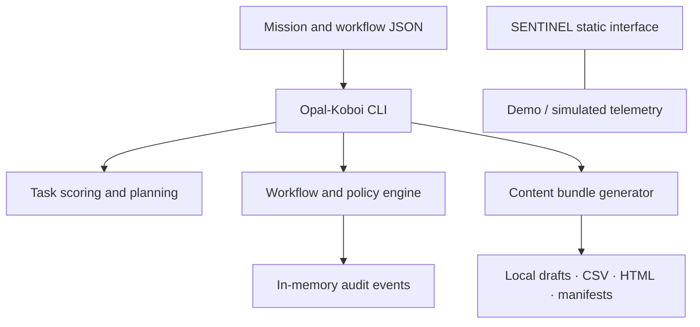

<!-- CLEARGLASSINC BRAND START -->
<p align="center">
  <a href="https://clearglassinc.com">
    
  </a>
</p>

<h1 align="center">ClearGlass Inc. · Opal-Koboi</h1>

<p align="center">
  <strong>Transparency Is Infrastructure.</strong><br>
  Mission planning, policy-aware workflow orchestration, and auditable automation.
</p>

<p align="center">
  <a href="https://clearglassinc.com">Website</a> ·
  <a href="./docs/RUNBOOK.md">Runbook</a> ·
  <a href="https://github.com/ClearGlassInc/Opal-Koboi/actions/workflows/ci.yml">CI checks</a> ·
  <a href="https://github.com/ClearGlassInc/Opal-Koboi/issues">Issues</a>
</p>
<!-- CLEARGLASSINC BRAND END -->

> **Engineering status:** This is a multi-component development repository, not a claim that every system is hosted or production-ready. The Node.js CLI supports local planning and workflow demonstrations. The SENTINEL control surface uses simulated/demo telemetry. Architecture documents and product proposals describe scope, not verified deployments.

**Navigate:** [Quick start](#quick-start) · [Repository map](#repository-map) · [Architecture](#architecture) · [Safety](#safety-and-operating-boundaries) · [Documentation](#documentation) · [Licensing](#licensing)

## At a glance

| Area | Available in the repository |
| --- | --- |
| **Plan** | Score and prioritize mission tasks from JSON inputs |
| **Orchestrate** | Run local workflow steps with policy and approval-gate checks |
| **Audit** | Capture workflow events through the in-memory audit ledger |
| **Prepare content** | Generate local Markdown drafts, CSV calendars, manifests, audit files, and print-ready HTML |
| **Explore** | Review the static SENTINEL interface, separate research modules, and supporting documentation |

These are descriptions of code paths, not guarantees of external integrations, durable storage, or live autonomous execution.

## Quick start

**Prerequisites:** Node.js 20+ and npm. The GitHub CI configuration uses Node.js 22.

```bash
git clone https://github.com/ClearGlassInc/Opal-Koboi.git
cd Opal-Koboi
npm ci
npm test
npm run build
npm run dashboard
npm run orchestrate
```

### Operator commands

| Command | Purpose |
| --- | --- |
| `npm run status` | Show the local CLI runtime summary |
| `npm run plan` | Score and prioritize the example mission |
| `npm run dashboard` | Render the example mission dashboard summary in the terminal |
| `npm run orchestrate` | Execute the example workflow through the local engine |
| `npm run content:deploy` | Write reviewable content drafts and accompanying audit metadata locally |
| `npm run ci` | Run the npm test and build sequence |

The bundled examples are [`examples/mission.json`](./examples/mission.json), [`examples/workflow.json`](./examples/workflow.json), and [`examples/trust-infrastructure-campaign.json`](./examples/trust-infrastructure-campaign.json).

> **Publishing boundary:** `deploy-content` creates local files. Even its `--approve` option changes local approval metadata only; it does **not** post to social networks, send messages, or publish anything externally. See [Content Deployment](./docs/CONTENT_DEPLOYMENT.md).

## Repository map

| Component | Source | Scope |
| --- | --- | --- |
| **Opal-Koboi CLI** | [`bin/`](./bin/), [`src/`](./src/), [`examples/`](./examples/) | Mission scoring, local workflow execution, policy evaluation, draft generation |
| **SENTINEL control surface** | [`index.html`](./index.html), [`spec.html`](./spec.html), [`assets/`](./assets/) | Static interface and simulated operating signals |
| **ClearFlow** | [`clearflow/`](./clearflow/) | Local workflow/automation research module |
| **ClearPulse** | [`clearpulse/`](./clearpulse/) | Triage/compliance demonstration using synthetic inputs and documented service seams |
| **ARTEMIS** | [`artemis/`](./artemis/), [`apps/artemis-agent/`](./apps/artemis-agent/) | Agent research code, local components, and implementation documentation |
| **Aerospace research tools** | [`AerospaceIntel.ps1`](./AerospaceIntel.ps1), [`PROJECT_OVERVIEW.md`](./PROJECT_OVERVIEW.md) | Separate legacy PowerShell/research materials; independently assess readiness and license terms |

Component scope and implementation maturity vary. Consult component documentation and tests before relying on a feature operationally.

## Architecture



<details>
<summary><strong>Technical implementation notes</strong></summary>

- `src/index.js` implements task normalization, scoring, and operation planning.
- `src/platform.js` provides the policy engine, workflow steps, and an **in-memory** audit ledger. Do not treat this ledger as durable, tamper-proof storage.
- `src/content-deployment.js` produces local review artifacts with an explicit human-approval state.
- `bin/opal-koboi.js` exposes the CLI commands. Its `run` pathway is a local simulation, not an authorization to operate external services.
- `index.html`, `spec.html`, and `assets/` are presentation surfaces; displayed signals are not proof of live back-end data.

</details>

## Safety and operating boundaries

- **Human approval:** Do not connect real-world actions, credentials, payments, or publication to these demonstrations without explicit approval and separate validation.
- **Evidence first:** Report observed tests and deployments rather than relying on brochure claims or simulated metrics.
- **Secret handling:** Keep credentials out of source control; use appropriate environment- or secret-management facilities.
- **Data separation:** Synthetic demos are not validated clinical, financial, defense, or investment outputs.
- **CI:** The workflow definition is [`.github/workflows/ci.yml`](./.github/workflows/ci.yml). Check the [latest run](https://github.com/ClearGlassInc/Opal-Koboi/actions/workflows/ci.yml) for its actual status; a README cannot certify a passing build.

## Documentation

| Read | Why |
| --- | --- |
| [Platform runbook](./docs/RUNBOOK.md) | Local commands and expected command behavior |
| [Content deployment](./docs/CONTENT_DEPLOYMENT.md) | Draft generation and manual-publication safeguards |
| [Engineering guidelines](./ENGINEERING_GUIDELINES.md) | Repository development rules and test expectations |
| [ClearPulse guide](./clearpulse/README.md) | Triage pipeline scope and known limitations |
| [ARTEMIS agent guide](./apps/artemis-agent/README.md) | Desktop-agent workspace and current code layout |
| [Security review](./docs/SECURITY_REVIEW.md) | Historical supply-chain findings; revalidate before relying on present status |

<details>
<summary><strong>Verification checklist for contributors</strong></summary>

1. Work on a scoped feature branch; preserve unrelated changes.
2. Run `npm ci && npm test && npm run build`, then `npm run dashboard && npm run orchestrate`.
3. For changes in Python or desktop subprojects, run their respective component tests.
4. Review diff and security implications; do not bypass failures or approval gates.
5. Record commit, checks, limitations, and rollback path in the pull request.

</details>

## Licensing

The root Node.js package identifies [`LICENSE`](./LICENSE) as **MIT**. This repository also contains a separate [`LICENSE.txt`](./LICENSE.txt) that sets out **commercial terms for legacy Aerospace Intelligence System materials**. These files should not be treated as interchangeable. Confirm the applicable rights for any component or asset before reuse or distribution.

---

<p align="center">
  <strong>ClearGlass Inc.</strong><br>
  See clearly. Operate securely.<br>
  <a href="https://clearglassinc.com">clearglassinc.com</a>
</p>
